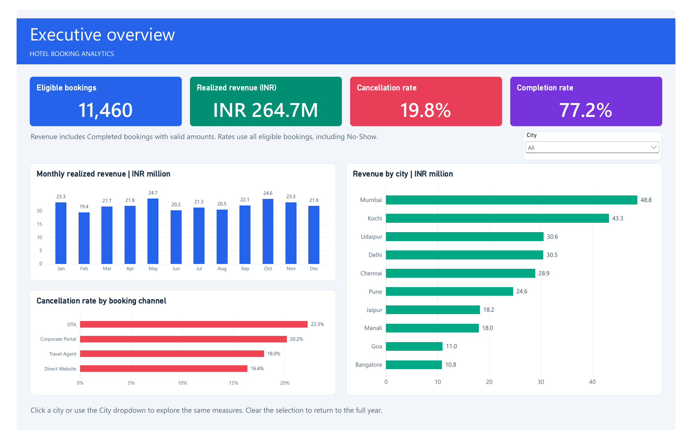

# Hotel Booking Analytics

Python, PostgreSQL and Power BI analysis of hotel revenue, cancellations and weather-related booking outcomes. The practice workbook contains 12,000 bookings; 11,460 remain eligible after the documented date and room checks.



Open the [Power BI report](dashboards/Hotel_Booking_Analytics.pbix), [dashboard PDF](docs/Dashboard.pdf), [case study](docs/Case_Study.docx) or [project requirements](docs/Project_Requirements.docx).

## Folder structure

```text
Hotel_Booking_Analytics/
  README.md                   Project guide and setup
  requirements.txt            Python dependencies
  .vscode/extensions.json     Recommended VS Code extensions
  python/                     Preparation, weather analysis and validation
  sql/                        Schema, loading, business queries and exports
  data/
    raw/                      Original workbook and API cache; local only
    cleaned/
      dashboard/              Four aggregate CSVs used by Power BI
      validation/             Data checks and supporting results; local only
      weather/                Detailed weather outputs; local only
      *.csv                   Prepared and normalized records; local only
  dashboards/
    Hotel_Booking_Analytics.pbix
    previews/executive_overview.png
  docs/
    Case_Study.docx            Findings, recommendations and explanations
    Dashboard.pdf             All three dashboard pages
    Project_Requirements.docx  Technical requirements
    private/                  Interview guide; local only
  archive/                    Superseded files; local only
```

## Why the CSVs and image are included

Power BI imports the four files below from `data/cleaned/dashboard`. They are grouped summaries, not copies of the original workbook. Keep them in the repository so the report can refresh after its DataFolder parameter is updated.

| File | Contents | Used for |
|---|---|---|
| `bookings.csv` | 480 city, month and channel groups | Executive metrics, revenue charts and cancellation matrix |
| `scenarios.csv` | Two cancellation scenarios | Estimated intervention impact |
| `seasonality.csv` | 36 city-month groups for Goa, Manali and Kochi | Seasonal cancellation comparison |
| `weather.csv` | Four city and precipitation groups | Weather outcomes and sample sizes |

The single PNG displays the executive dashboard directly on this GitHub page. The PBIX is the interactive report; `docs/Dashboard.pdf` lets visitors view all three pages without Power BI. Preparation tables, quality checks, API responses and detailed records are generated locally and excluded from Git. The source workbook is not included; the published aggregate inputs are sufficient to refresh the report, while rerunning the full pipeline requires the workbook.

## Run the analysis

Install Python 3.12+, PostgreSQL and Power BI Desktop. VS Code offers the extensions listed in `.vscode/extensions.json`; no extra extension is required to run the scripts.

Run these commands from the repository root:

```powershell
python -m venv .venv
.venv\Scripts\Activate.ps1
python -m pip install -r requirements.txt
```

Place the supplied workbook at `data/raw/hotel_bookings.xlsx`, then run:

```powershell
python python/01_prepare_data.py
```

Create a PostgreSQL database called `hotel_booking_analytics`. With `psql` on PATH, run:

```powershell
psql -h localhost -U postgres -d hotel_booking_analytics -v ON_ERROR_STOP=1 -f sql/01_create_tables.sql -f sql/02_load_data.sql -f sql/03_business_queries.sql -f sql/04_cancellation_analysis.sql -f sql/05_dashboard_views.sql -f sql/06_export_results.sql -o data/cleaned/validation/sql_results.txt
python python/02_weather_analysis.py
python python/03_validate_outputs.py
```

Enter your database password when prompted. The load script replaces the three project tables' rows in one transaction. Run it through `psql`, which supports the client-side `\copy` commands.

After moving or cloning the project, open the PBIX and set **Transform data > Manage parameters > DataFolder** to that clone's absolute `data/cleaned/dashboard` path before refreshing. The saved report contains the aggregate snapshot and can be viewed without PostgreSQL. Database changes require a new SQL export and Power BI refresh; this is Import mode.

## Results and definitions

| Measure | Result |
|---|---:|
| Eligible bookings | 11,460 |
| Completed | 8,848 / 77.21% |
| Cancelled | 2,267 / 19.78% |
| No-Show | 345 / 3.01% |
| Realized revenue | INR 264,722,151.63 |
| Weather-matched bookings | 926 |

Revenue counts Completed bookings with valid amounts. Cancellation rate is Cancelled divided by all eligible bookings; No-Show is separate. Rates are recomputed from counts. Month means check-in month; lead time is check-in date minus booking date.

Date/room errors exclude 540 unique bookings. Cancelled review fields are cleared without dropping those bookings. The 35 pricing discrepancies exclude affected Completed amounts from primary revenue while preserving otherwise valid cancellation records. Literal loyalty tier `None` is retained; blank coupons and `NONE` mean the same thing. Rating scales are reported separately by segment.

The long-lead what-if estimates 154.72 fewer cancellations, or 1.35 platform percentage points at fixed volume. This does not support the illustrative five-point target. Deposit-policy effects are assumptions to test. Heavy-precipitation failed-booking gaps are +17.47 points for Goa and +7.41 for Manali; these are associations, not proof of cause.

The report covers the executive overview, cancellation drivers and weather outcomes. The executive City filter changes its measures. Diagnostic baseline/scenario cards stay fixed and are labelled accordingly. The case study contains the full arithmetic, competing explanations, schema, SQL, index justification and limitations.

## Weather tool quick guide

```text
Enriches eligible Goa and Manali bookings with Open-Meteo daily weather.
Install the central requirements.txt packages and prepare the workbook first.
Run python python/02_weather_analysis.py for live API requests.
Add --cached to reuse responses in data/raw/weather after a successful live run.
Design: one request per city/date range and a validated many-to-one date/city join.
Limitation: city estimates, missing cancellation times and shared dates prevent causal claims.
```

## Data and local files

This is a historical practice-data case study. The workbook's redistribution licence has not been established, so source records and detailed outputs remain local. Only aggregate dashboard inputs are included in Git; they contain no customer names, customer IDs or booking IDs. The validator checks this scope and the known snapshot totals.

The single `archive/` folder preserves earlier layouts, original documents, duplicate reports, editable Power BI project definitions and development material. It is entirely ignored by Git. The original brief is preserved there unchanged; `docs/Project_Requirements.docx` is its neutral project version.

Weather source: [Open-Meteo Historical Weather API](https://open-meteo.com/en/docs/historical-weather-api).
